<div align="center">

[](https://git.io/typing-svg)

<a href="https://www.linkedin.com/in/brunodutraaa/"></a>
<a href="https://portfoliobrunodutra.vercel.app"></a>


</div>

## 👋 Sobre mim

```yaml
nome:          Bruno Moreira Dutra
localização:   São Paulo, Brasil
formação:      Engenharia de Software @ UNICID
base_técnica:  Análise e Desenvolvimento de Sistemas @ SENAI
foco:          Python • Flask • APIs REST • Bancos de dados
```

Gosto de transformar regras de negócio em aplicações organizadas e funcionais. Tenho direcionado meus estudos ao desenvolvimento back-end, trabalhando com autenticação, controle de acesso, bancos de dados, consumo de APIs e testes automatizados.

Atualmente, desenvolvo projetos próprios para aprofundar meus conhecimentos e construir um portfólio que demonstre não apenas as tecnologias que conheço, mas também os problemas que consigo resolver com elas.

## 🛠️ Tecnologias e ferramentas

<div align="center">

### Back-end e banco de dados


### Front-end e desenvolvimento


</div>

Também utilizo **SQLAlchemy**, **Flask-Migrate**, **Pytest**, **Jinja** e integração com **APIs REST** nos meus projetos.

## 🚀 Projetos em destaque

<div align="center">

<a href="https://github.com/DutraBrun0/ProdManager">
  
</a>

<a href="https://github.com/DutraBrun0/FPS-ASCII">
  
</a>

<a href="https://github.com/DutraBrun0/incident-0317">
  
</a>

</div>

## 🎓 Formação

- **Engenharia de Software — UNICID**  
  Graduação em andamento.

- **Análise e Desenvolvimento de Sistemas — SENAI/SP**  
  Curso técnico concluído.

<br>


